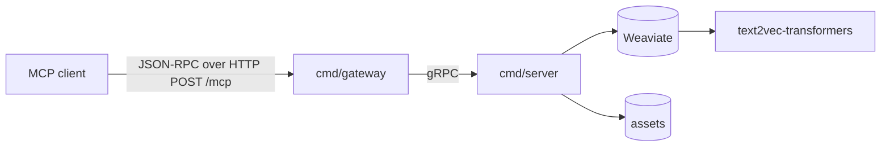

# precedent-mcp

`precedent-mcp` is an MCP server that stores context entries and architecture decisions in Weaviate, shared across agent sessions.

## Features

| Feature | Content |
|---|---|
| Context memory | Save, search and replay context entries grouped by thread |
| Decision records | Record architecture decisions, supersede them and review how they held up |
| Hybrid search | Weaviate vector and keyword search, ranked by review results |
| Skills | Five MCP skills that guide agents through capture, recall, decision and review |

## Quick start

| Requirement | Purpose |
|---|---|
| Podman with `podman compose` | Build, push and run the images |
| Docker Hub account | Host the pushed images |

`deploy/deploy.sh` logs in to `docker.io`, builds and pushes both images, then starts `deploy/docker-compose.yml`:

```
DOCKER_ACCOUNT=<account> ./deploy/deploy.sh
```

Connect Claude Code to the gateway:

```
claude mcp add --transport http precedent-mcp http://localhost:8083/mcp
```

| Compose service | Image | Network |
|---|---|---|
| `precedent-mcp-gateway` | `docker.io/<account>/precedent-mcp-gateway:1.0.0` | `default`, published on `127.0.0.1:8083` |
| `precedent-mcp-server` | `docker.io/<account>/precedent-mcp-server:1.0.0` | `default`, `weaviate` |
| `weaviate` | Upstream Weaviate image, data in named volume `weaviate-data` | `weaviate` |
| `text2vec-transformers` | Upstream transformers inference image | `weaviate` |

`deploy/Dockerfile` builds targets `server` and `gateway` on `gcr.io/distroless/static-debian12:nonroot`. Network `weaviate` is internal.

## Usage

### Tools

Schemas live in `assets/tools.yaml`.

| Tool | Purpose |
|---|---|
| `add_context` | Save 1 to 10 context entries in one call; each entry names its own thread |
| `retrieve_context` | Search stored context entries by meaning and keywords |
| `get_context_thread` | Get the latest 20 context entries of one thread |
| `record_decision` | Save an architecture decision with situation, choice, rationale, options, trade-offs, facts and practices |
| `retrieve_decisions` | Search current decisions (accepted and proposed) by meaning and keywords |
| `review_decision` | Record how well a past decision held up |

### Skills

Each skill lives in `assets/skills/<name>/` as `SKILL.md`, `metadata.yaml` and `examples.md`.

| Skill | Purpose |
|---|---|
| `precedent-capture` | Save durable knowledge from the conversation |
| `precedent-decide` | Draft a decision record for a design choice |
| `precedent-recall` | Load earlier context when a session starts |
| `precedent-refine` | Revise a proposed decision until it is decided |
| `precedent-review` | Score how an accepted decision held up |

### Resources

| Resource URI | Content |
|---|---|
| `skill://<name>` | `SKILL.md` of the skill |
| `examples://<name>` | `examples.md` of the skill |

### MCP methods

Protocol version: `2026-07-28`.

| JSON-RPC method | gRPC service | gRPC method |
|---|---|---|
| `server/discover` | `CapabilityService` | `Discover` |
| `tools/list` | `ToolService` | `ListTools` |
| `tools/call` | `ToolService` | `CallTool` |
| `resources/list` | `ResourceService` | `ListResources` |
| `resources/read` | `ResourceService` | `ReadResource` |
| `skills/list` | `SkillService` | `ListSkills` |
| `skills/get` | `SkillService` | `GetSkill` |

## Configuration

Both binaries load `.env` from the working directory. Variables already set in the process environment keep their values.

| Variable | Binary | Example value |
|---|---|---|
| `WEAVIATE_HOST` | `server` | `weaviate:8080` |
| `WEAVIATE_SCHEME` | `server` | `http` |
| `WEAVIATE_TEXT2VEC_MODEL` | `server` | `text2vec-transformers` |
| `GRPC_PORT` | `server` | `50051` |
| `GRPC_ADDRESS` | `gateway` | `localhost:50051` |
| `HTTP_PORT` | `gateway` | `8080` |
| `ALLOWED_ORIGINS` | `gateway` | `http://localhost:*,http://127.0.0.1:*,http://[::1]:*` (default when unset) |

`.env.example` holds a complete set of values.

## Architecture



| Layer | Package | Responsibility |
|---|---|---|
| Gateway | `cmd/gateway`, `gateway` | Protocol checks, JSON-RPC unwrapping and wrapping, CORS, gRPC clients |
| gRPC contract | `communication/*.proto`, `gen/proto/v1` | One service per MCP capability |
| Service | `cmd/server`, `internal/service` | Business input checks, store calls, results, MCP URIs |
| Store | `internal/db`, `internal/asset` | Weaviate classes `Context` and `Decision`; tool and skill files under `assets` |

## Development

| Requirement | Used by |
|---|---|
| Go 1.26 | Every target |
| `protoc` with `protoc-gen-go` and `protoc-gen-go-grpc` | `make generate` |
| Weaviate with the `text2vec-transformers` module | `make run`, `make e2e` |

| Command | Effect |
|---|---|
| `make generate` | Generate `gen/proto/v1` from `communication/*.proto` |
| `make mocks` | Generate `mocks_test.go` files with mockery, configured in `.mockery.yml` |
| `make build` | Build `bin/server` and `bin/gateway` |
| `make run` | Build, then run `bin/server` and `bin/gateway` until either exits |
| `make test` | Run unit tests with coverage |
| `make e2e` | Build and start both binaries on free ports, then run the `e2e` suite through the gateway |
| `make tidy` | Run `go mod tidy` |

## License

`precedent-mcp` is released under the MIT License, full text in `LICENSE`.
