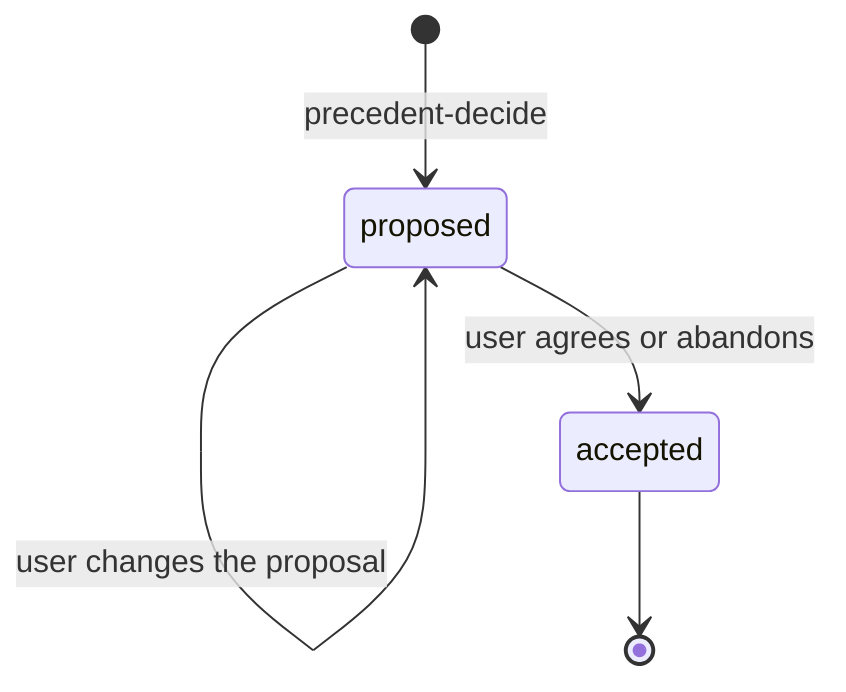

# precedent-refine

## Revision rules

| Rule | Value |
|---|---|
| Revision | Always a new decision record; no tool updates a record in place. |
| Content | Every field of the revised decision, not only the change |
| Reopening | Re-check the evidence before reopening a rejected option. |
| Acceptance condition | Accept only after the condition in `rationale` is met. |
| Replaced decision | A proposal with `supersedes` already hides the accepted decision it replaces. |
| Scoring | Drafts are never scored; scoring belongs to `precedent-review`. |

## Steps

| Event | Action | Tool | Argument choices |
|---|---|---|---|
| Before every `record_decision` | Find the current version; an outdated `supersedes` leaves two current decisions. | `retrieve_decisions` | `query`: the decision `title`; the returned `decision_id` is the current `decision_id`. |
| The user changes the proposal | Record the revised decision. | `record_decision` | `status`: `proposed`; `supersedes`: the current `decision_id`. |
| The user agrees | Record the final decision. | `record_decision` | `status`: `accepted`; `supersedes`: the current `decision_id`. |
| The user abandons the proposal | Record the rejection. | `record_decision` | `status`: `accepted`; `decision` starts with "Not adopted:" and the reason, then restates the replaced decision as still in force; `supersedes`: the current `decision_id`. |

## Exit

| Result | Next |
|---|---|
| An `accepted` record exists | Continue the task. |
| The proposal is still open when the task ends | `precedent-capture` saves the open point in the summary entry. |

## Examples (at most 15 lines)
